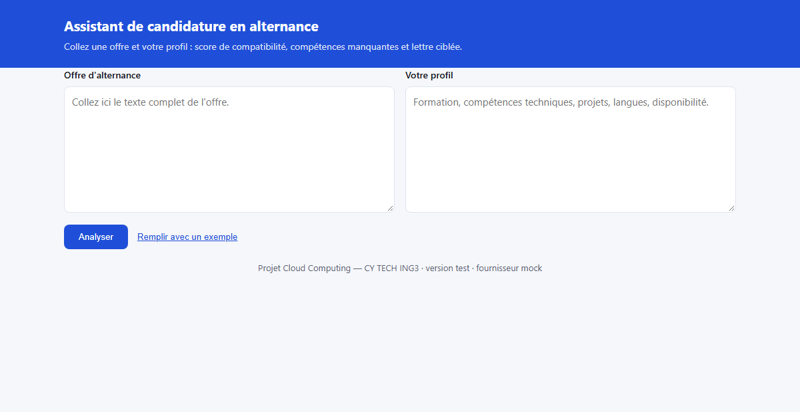

# Assistant de candidature en alternance

Application web qui compare une offre d'alternance au profil d'un candidat et renvoie un score de compatibilité, les compétences à renforcer et une lettre de motivation ciblée, générée par un modèle de langage hébergé sur Azure OpenAI.

Projet du module **Cloud Computing** (CY TECH, ING3 BI) : conteneurisation, pipeline d'intégration et de déploiement continus, mise en production sur Microsoft Azure.

---

## 1. Le problème traité

Un étudiant en recherche d'alternance envoie des dizaines de candidatures. Deux tâches reviennent à chaque fois et prennent du temps :

1. évaluer si son profil correspond réellement à l'offre, avant d'investir une heure de rédaction ;
2. réécrire une lettre de motivation spécifique, car une lettre générique est écartée.

L'application automatise ces deux étapes. Elle ne remplace pas le candidat : elle produit un premier jet argumenté et désigne les compétences à travailler, ce qui reste exploitable même quand le score est faible.



## 2. Architecture

```
Navigateur
    |  HTTPS
    v
Azure Container Apps  (ingress externe, 0 à 5 replicas, mise à l'échelle automatique)
    |  clé stockée en secret de l'application
    v
Azure OpenAI  (déploiement gpt-4o-mini)
```

L'image est publiée dans **Azure Container Registry**, construite et déployée par **GitHub Actions**.

### Choix d'hébergement

Le cours présente trois options pour exécuter un conteneur sur Azure : ACI, App Service for Containers et AKS. **Azure Container Apps** a été retenu pour trois raisons :

- la mise à l'échelle jusqu'à zéro replica : l'application ne coûte rien lorsqu'elle n'est pas utilisée, ce qui compte avec un crédit étudiant limité ;
- la gestion intégrée du certificat TLS et du nom de domaine, absente d'ACI ;
- l'absence de cluster à administrer, contrairement à AKS, dont la complexité n'est pas justifiée pour un service unique.

ACI aurait imposé de créer autant d'instances que de replicas et de gérer le certificat à la main. AKS aurait ajouté une couche d'exploitation sans bénéfice ici.

## 3. Pile technique

| Élément | Choix | Raison |
|---|---|---|
| API | FastAPI (Python 3.13) | validation des entrées par Pydantic, documentation OpenAPI automatique |
| Interface | HTML et JavaScript natifs | aucune étape de build, image plus légère |
| Modèle | Azure OpenAI, gpt-4o-mini | sortie JSON imposée, coût faible |
| Conteneur | python:3.13-slim | image réduite, utilisateur non privilégié |
| Registre | Azure Container Registry | privé, intégré à Container Apps |
| CI/CD | GitHub Actions | demandé par le sujet |

## 4. Lancer en local

### Avec Docker Compose

```bash
cp .env.example .env     # LLM_PROVIDER=mock suffit pour une première prise en main
docker compose up --build
```

L'application répond sur http://localhost:8000

### Sans Docker

```bash
pip install -r requirements-dev.txt
export LLM_PROVIDER=mock
uvicorn app.main:app --reload
```

### Les trois modes du fournisseur

La variable `LLM_PROVIDER` détermine la source des réponses :

- `mock` : réponse figée, aucun appel réseau. Utilisé par les tests automatisés et pour démontrer l'interface sans abonnement Azure.
- `azure` : Azure OpenAI. Mode utilisé en production.
- `openai` : toute API compatible OpenAI, utile pendant le développement.

Ce découplage évite de dépendre d'un abonnement Azure pour développer et pour faire tourner la chaîne d'intégration continue.

## 5. Tests

```bash
pytest -q
```

Quatre tests couvrent la sonde de disponibilité, le format de la réponse d'analyse, le refus d'une entrée trop courte et le service de la page d'accueil.

## 6. Déploiement sur Azure

### Première mise en place

```bash
az login
bash infra/deploy.sh
```

Le script crée le groupe de ressources, le registre, la ressource Azure OpenAI et son déploiement de modèle, l'environnement Container Apps puis l'application. Il affiche à la fin l'URL publique et la liste des secrets à enregistrer dans GitHub.

### Secrets GitHub à configurer

Dans **Settings > Secrets and variables > Actions** :

| Secret | Contenu |
|---|---|
| `AZURE_CREDENTIALS` | JSON produit par `az ad sp create-for-rbac --sdk-auth` |
| `ACR_NAME` | nom du registre, sans le suffixe `.azurecr.io` |
| `AZURE_RESOURCE_GROUP` | nom du groupe de ressources |
| `CONTAINERAPP_NAME` | nom de la Container App |

Le principal de service reçoit le rôle **Contributor** limité au seul groupe de ressources du projet, conformément au principe de moindre privilège vu en cours.

### Supprimer les ressources

```bash
bash infra/destroy.sh
```

## 7. Le pipeline

Déclencheur : chaque `push` et chaque `pull request` sur `main`.

**Étape 1 — Tests et qualité d'image** (sur les deux événements)

1. récupération du code ;
2. installation des dépendances, avec cache pip ;
3. exécution de `pytest` en mode `mock` : aucun secret nécessaire, donc le pipeline fonctionne aussi sur une pull request issue d'un fork ;
4. construction de l'image Docker ;
5. démarrage du conteneur et appel de `/health` jusqu'à réponse : vérifie que l'image produite démarre réellement, ce qu'un simple `docker build` ne garantit pas ;
6. analyse des vulnérabilités de l'image avec Trivy.

**Étape 2 — Déploiement** (uniquement sur `push` vers `main`, après succès de l'étape 1)

1. authentification auprès d'Azure via le principal de service ;
2. `az acr build` : l'image est construite par le registre, ce qui évite de transférer plusieurs centaines de mégaoctets depuis le runner ;
3. double marquage de l'image : le SHA du commit et `latest`. Le déploiement référence le SHA, jamais `latest`, afin que chaque version mise en ligne soit identifiable et qu'un retour arrière consiste simplement à redéployer le SHA précédent ;
4. `az containerapp update` : Container Apps crée une nouvelle révision et bascule le trafic une fois la sonde de disponibilité satisfaite ;
5. affichage de l'URL publique.

## 8. Décisions techniques

**Image sans privilèges.** Le conteneur s'exécute sous l'utilisateur `appuser` (UID 10001) et non sous `root`, ce qui limite la portée d'une compromission applicative.

**Ordre des couches.** Les dépendances sont installées avant la copie du code. Une modification du code ne reconstruit donc que la dernière couche, conformément au fonctionnement du cache de couches vu en cours.

**Contexte de build restreint.** Le fichier `.dockerignore` exclut `.git`, `.env`, les clés et les tests. Il évite d'embarquer un secret dans une couche d'image, où il resterait lisible même après suppression dans une couche ultérieure.

**Secret hors de l'image et hors du dépôt.** La clé Azure OpenAI est injectée comme secret de Container App et référencée par `secretref:`. Elle n'apparaît ni dans le code, ni dans l'image, ni dans les journaux.

**Sonde de disponibilité.** `/health` renvoie la version déployée et le fournisseur actif. Container Apps s'en sert pour décider si une révision est saine avant de lui envoyer du trafic.

**Mise à l'échelle de 0 à 5 replicas.** Le minimum à zéro supprime le coût à l'arrêt, au prix d'un démarrage à froid sur la première requête. Ce compromis convient à un projet pédagogique ; une application de production utiliserait un minimum de 1.

**Journaux structurés en JSON.** Ils sont exploitables directement par Log Analytics, sans analyse syntaxique supplémentaire.

## 9. Limites connues

- Le démarrage à froid ajoute quelques secondes à la première requête après une période d'inactivité, conséquence assumée du minimum à zéro replica.
- Aucune donnée n'est conservée : l'application ne stocke ni les offres ni les profils soumis. C'est un choix de confidentialité, qui interdit en contrepartie l'historique.
- Le score produit par le modèle est indicatif et peut varier d'un appel à l'autre.
- L'analyse des vulnérabilités signale les failles sans faire échouer la construction (`exit-code: 0`), afin qu'une faille non corrigible en amont ne bloque pas les rendus.

## 10. Structure du dépôt

```
.
├── app/
│   ├── main.py            API FastAPI, sonde de disponibilité
│   ├── llm.py             client LLM : azure, openai ou mock
│   └── static/index.html  interface
├── tests/test_api.py      tests automatisés
├── infra/
│   ├── deploy.sh          création de l'infrastructure Azure
│   └── destroy.sh         suppression des ressources
├── .github/workflows/ci-cd.yml
├── Dockerfile
├── compose.yml
└── .dockerignore
```
